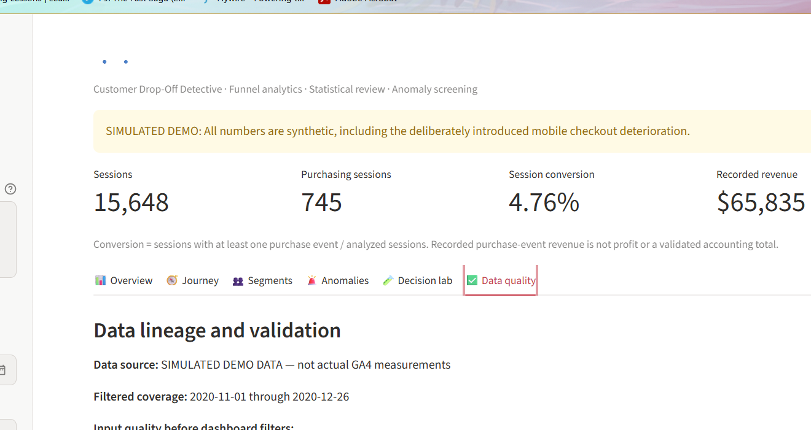
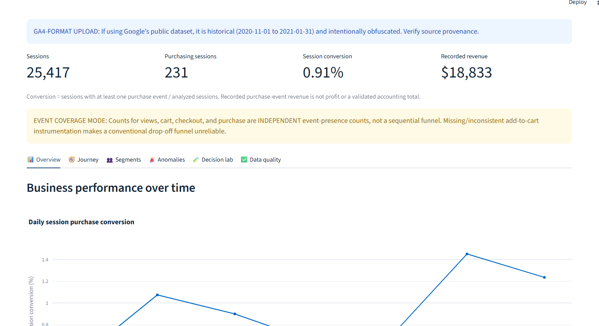
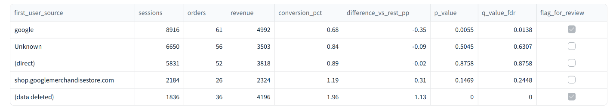
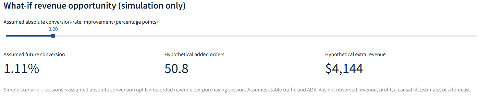
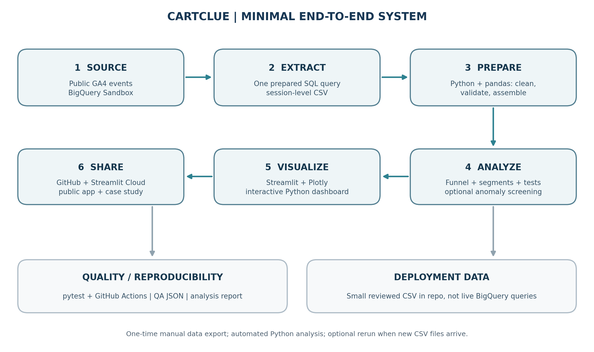

# 🛒 CartClue | Customer Drop-Off Detective

**Investigate ecommerce purchase conversion, detect measurement problems, compare customer segments, and turn observations into testable business questions.**

[**Live Streamlit App**](https://cartclue-growth-investigator.streamlit.app/) · [**Real GA4 Case Study**](docs/CASE_STUDY.md) · [**Architecture**](docs/ARCHITECTURE.md) · [**Investigation Decision Note**](docs/DAY4_DECISION_NOTE.md)



> **What you're viewing:** The public app starts with a **SIMULATED** dataset so anyone can try the interactive features. The **real** analysis below used a separate historical, deliberately obfuscated GA4 sample (Nov 1–7, 2020). These are **not** live analytics, audited sales, or a validated production ML model.

## Executive summary

I built CartClue as an end-to-end, low-cost data science portfolio project using **BigQuery SQL, Python/pandas, statistical testing, scikit-learn, Plotly, Streamlit, pytest, and GitHub Actions**. It extracts and validates ecommerce sessions, compares customer groups, explains measurement limitations, and estimates *hypothetical* opportunities. The app and historical investigation are kept distinct so simulated metrics cannot be mistaken for real observations.

**The strongest finding was a data-quality problem, not a flashy conversion claim:** An initial strict funnel incorrectly showed zero purchases because the obfuscated sample contained almost no add-to-cart events. I diagnosed the issue against the original event data and revised the analysis to show **independent event coverage** and preserve observed purchases and revenue instead of treating missing intermediate events as customer drop-off.

## Real-data case study: 7 historical days

| Metric | Observed in analyzed GA4 extract |
|---|---:|
| Reconstructed sessions | **25,417** |
| Sessions containing a purchase event | **231** |
| Purchase-session rate | **0.91%** |
| Recorded purchase-event revenue | **$18,833** |
| Sessions with recorded add-to-cart | **1** |
| Sessions with recorded checkout | **877** |
| `google` first-user source | **0.68%** purchase-session rate (61/8,916) |
| Other first-user source groups | **1.03%** (170/16,501) |
| Google-vs-rest adjusted q-value | **0.0138** |
| `Unknown` + `(data deleted)` source labels | **33.4%** of analyzed sessions |

**Interpretation:** The first-user `google` segment had a lower observed purchase-session rate than other source groups after the dashboard's within-dimension multiple-testing correction. That does **not** establish that Google traffic *causes* lower conversion, nor justify cutting marketing spend. Attribution labels were incomplete/obfuscated, and session-level tests may be overconfident when repeat sessions belong to the same user.





Read [the complete case study](docs/CASE_STUDY.md) for problem framing, hypotheses, statistical interpretation, recommended audit, proposed A/B experiment, and limitations.

## Product functionality

- **Overview:** Purchasing sessions, purchase-session conversion, revenue, and daily trends.
- **Journey:** Strict ordered funnel **for the simulated demo**; **independent event coverage** for the corrected obfuscated GA4 extract. Never equate missing events with proven abandonment.
- **Segments:** Device, geography, and first-user acquisition-source comparisons with two-proportion z-tests, sample-size checks, and Benjamini–Hochberg adjusted q-values.
- **Anomalies:** Exploratory Isolation Forest screening when at least **30 dates** are available. The analyzed real-data week had **only 7 days**; no validated real-data ML anomaly results are claimed.
- **Decision lab:** Hypothesis prompts and scenario math. The +0.20 percentage-point uplift illustration yielded about **50.8 hypothetical additional purchasing sessions** and **$4,144 hypothetical extra recorded revenue** at the sampled volume/AOV. **Not actual uplift, a forecast, or profit.**
- **Data quality:** Reconstructed session-grain checks, duplicate IDs, missing dates/keys, revenue validation, and measurement-mode warnings.



## System architecture



**Public GA4 events → BigQuery SQL session extract → local CSV → Python/pandas validation → descriptive analytics / statistical tests → Streamlit dashboard → GitHub + Streamlit Community Cloud.**

The public deployment reads a small **simulated demo CSV**, not private files or a live BigQuery connection. Source code tests run in GitHub Actions whenever `main` is updated. See [architecture and tool decisions](docs/ARCHITECTURE.md).

## Reproduce locally (Windows)

Requires Python 3.12 or 3.13. In the repository folder (where `app.py` exists):

```powershell
py -3.13 -m venv .venv
.\.venv\Scripts\python.exe -m pip install -r requirements.txt
.\.venv\Scripts\python.exe scripts\sprint.py demo
.\.venv\Scripts\python.exe scripts\sprint.py check
.\.venv\Scripts\python.exe scripts\sprint.py launch
```

Open `http://localhost:8501` if the browser does not launch automatically. The synthetic demo is usable without BigQuery credentials.

**Reproduce historical analysis:** Run [`sql/01_inspect_events.sql`](sql/01_inspect_events.sql) and the **corrected** [`sql/02_export_sessions.sql`](sql/02_export_sessions.sql) in [BigQuery Sandbox](https://console.cloud.google.com/bigquery). Export the flat query results into `data/ga4_exports/` and run:

```powershell
.\.venv\Scripts\python.exe scripts\sprint.py ingest --folder data/ga4_exports
.\.venv\Scripts\python.exe scripts\generate_report.py --input data/ga4_sessions_clean.csv --output reports/ga4_analysis.md
```

Then upload `data/ga4_sessions_clean.csv` from the app sidebar. **Do not mix exports created by the original strict-funnel SQL with the corrected event-coverage extraction.** The 25,417-session metrics correspond only to the stated Nov 1–7, 2020 extract; results may vary if settings or extraction logic differ.

## Testing and deployment

- **Unit tests:** 16 local tests passed during development.
- **CI:** GitHub Actions workflow under `.github/workflows/ci.yml` runs Python tests automatically on pushes.
- **Hosting:** Public Streamlit Community Cloud app; no paid cloud backend required.
- **Public data policy:** Only the synthetic demo CSV and aggregate screenshots/case-study numbers are intended for this repo. Local session-level CSVs, `.venv`, credentials, and secrets stay out.

## Limitations and next steps

- Historical, anonymized and **obfuscated** GA4 sample; not representative of 2026 behavior.
- Incomplete `add_to_cart` coverage prevents defensible conventional cart-abandonment measurement.
- First-user source is **not** the current session's acquisition channel or campaign ROI.
- Statistical segment tests are exploratory, subject to repeated users and confounding.
- Revenue is a recorded event-field total, not audited accounting revenue.
- No completed A/B test or demonstrated incremental revenue.
- Optional next iteration: longer observation window, robustness checks, more reliable event instrumentation, and pre-registered experimentation.

**References:** [Google GA4 ecommerce sample](https://developers.google.com/analytics/bigquery/web-ecommerce-demo-dataset) · [BigQuery Sandbox](https://cloud.google.com/bigquery/docs/sandbox) · [Streamlit deployment](https://docs.streamlit.io/deploy/streamlit-community-cloud) · [GitHub Actions](https://docs.github.com/en/actions)
