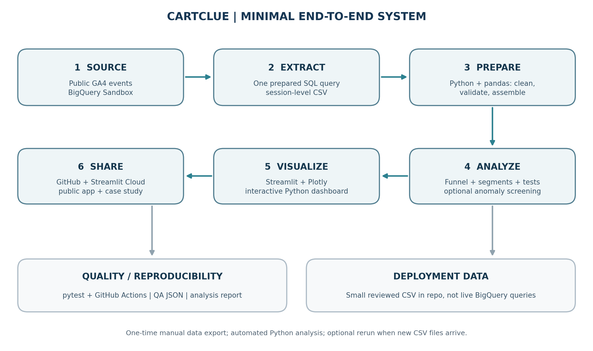

# CartClue — Minimal System Architecture

## One-sentence architecture
`Google public GA4 events (BigQuery)` → `corrected SQL session extract` → `downloaded CSV` → `Python validation/analytics` → `Streamlit + Plotly dashboard`; `GitHub Actions` runs automated tests and `Streamlit Community Cloud` hosts a **synthetic-data default demo**.

## What each piece does—and why it belongs

| Component | Responsibilities | Why this tool rather than more infrastructure? |
|---|---|---|
| BigQuery SQL | Read GA4 nested `event_params`; reconstruct pseudonymous session keys; aggregate independent event flags and purchase revenue | Source is already in BigQuery; one prepared query is simpler than pulling nested raw events locally |
| CSV | Transfer flat session table from BigQuery into local Python | Free and easy to audit for this bounded project |
| Python + pandas | Clean, deduplicate, validate, aggregate, calculate rates and prepare features | Most transformations can be automated using one language |
| SciPy | Compare segment purchase-session rates with z-tests and corrections | Lightweight, transparent statistical screening |
| scikit-learn | Optional Isolation Forest anomaly screen (only for sufficient time coverage) | Demonstrates a machine-learning technique but is not needed for 7-day real-data conclusions |
| Plotly + Streamlit | Interactive tabs, upload, filters, KPIs, event coverage, recommendations and scenario slider | Entire dashboard stays in Python—no separate frontend/backend |
| pytest + GitHub Actions | Regression tests on local machine and each GitHub push | Catches future code regressions automatically |
| GitHub + Streamlit Community Cloud | Public source code, documentation, free demo deployment | Recruiter can open it without installing dependencies |

## Data flow and mode selection

1. `sql/01_inspect_events.sql` checks raw event counts.
2. `sql/02_export_sessions.sql` exports flat rows in *observed-event mode*. Source diagnostics showed only four raw add-to-cart events, so purchases and revenue cannot be gated behind a full sequential funnel.
3. Local `scripts/sprint.py ingest --folder data/ga4_exports` creates validated `data/ga4_sessions_clean.csv`, quality audit and report. This cleaned local file is not required for public deployment.
4. `app.py` loads **synthetic** `data/demo_sessions.csv` by default and supports **user-uploaded** compatible CSVs. In real GA4 mode, the Journey view shows independent event coverage, not calculated cart abandonment.
5. Business decision lab simulates a specified absolute percentage-point uplift; it does not estimate a causal effect.
6. CI (`.github/workflows/ci.yml`) validates code on GitHub; Community Cloud runs `app.py` from `main` and updates when changes are committed.

## Why no API, Docker, Airflow, database server, or paid LLM?

The source is historical, file-based and bounded. Additional services would increase cost and complexity without improving the minimum viable analytical investigation. Future productionization would need authenticated ingestion, reliable event instrumentation, a persisted warehouse, monitoring and an operational SLA; none is represented as already built here.

## Reliability boundaries

- Format/data-quality checks are **not** proof that the source instrumentation is complete.
- Correlation in first-user source groups is **not** causal evidence or ad spend ROI.
- GitHub test success checks implemented code, not live customer funnel validity.
- One historical week is insufficient to evaluate anomaly models robustly.

**Outputs:** Public simulated demo · aggregate historical case study · corrected extract SQL · tested Python pipeline · reproducible analysis instructions.
